# 新ポイント処理概要

## 修正履歴

### 2026/10/16

- 初版

## 全体の俯瞰図

- オンラインの同期処理、オンバッチの非同期処理、CDPFとのファイル連携をまとめて示す。
- 矢印は主な要求・データの向きであり、すべての実行順序や応答は示していない。
- 通常バッチの起動元・起動スケジュールは別途確定する。
- 取込・出力処理の3世代バックアップは、すぐに内容を参照できるよう、内部作業用S3に非圧縮のファイルとして保持する。
- 履歴保管用S3にはgzip圧縮したファイルのみを保存する。履歴作成のための圧縮によって、内部作業用S3の非圧縮ファイルを置き換えない。

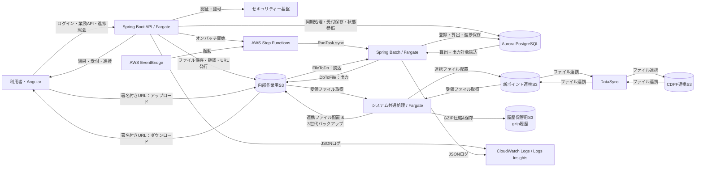

## バッチ

### バッチの概要

- バッチ処理はSpring Batchを使用して実装されており、原則として、以下の3つの処理を行う。
- 業務処理に関しては必ず冪等性を担保し、同じデータに対して複数回処理を行っても結果が変わらないようにする。
- 問題発生時には原則としてリランで解決できることが望ましいが、大容量データなどの処理でリランでは解決できない場合はチェックポイントを用いたリスタートなどのリカバリプランも検討する。
- 稼働はAWS Fargateを使用し、コンテナとして稼働させる。
- AWS Step FunctionsはStandard Workflowを使用し、ECS/Fargateタスクは`ecs:runTask.sync`で起動して終了を待機する。
- 業務バッチアプリのスペックは4vCPU、16GBメモリ、内部ストレージ50GBを想定している。
- DBはAurora PostgreSQLを利用想定。
- ログに関してはMDCを使用して、バッチIDやジョブ名、ジョブ実行IDなどの情報をログに出力する。
- 出力するログはlogstash-logback-encoderのLogstashEncoder等を使用してJSON形式で出力、CloudWatch Logs Insightsで検索可能なようにする。
- 出力先は標準出力(STDOUT/STDERR)に出力し、CloudWatch Logsに転送する。

### 取込処理(FileToDb)

- 原則チャンクモデルにて処理を行う。
- CDPFの連携S3から新ポイント用の連携S3へデータ連携(AWS DataSync)
- 内部作業用S3内にデータをバックアップ(最大3世代として保持)
- 新ポイントの連携S3からデータを内部作業用S3にコピー(AWS CLI syncまたはcpコマンド)
- 内部作業用S3からデータをgzipに圧縮し履歴保管用S3にコピー(AWS CLI syncまたはcpコマンド)
- ReaderにてAWS SDKを用いて内部作業用S3からデータをInputStreamReaderで取得し1件ずつ読み込み
- Processorにて1件ずつデータを変換し、WriterにてDBに格納する。
- チャンクサイズは初期値1000程度とし、メモリ使用を考慮して適宜調整する。
- 大量データの取り込み処理に関してはWriterはPostgreSQLのCOPYコマンドの利用を検討する。
- 通常のWriterはMyBatisBatchItemWriterを利用し、DBのバルクインサートを使用する。
- Insert、Updateの判断が必要な場合Classifierを使用して行い、実際に処理するWriterは通常のWriterであるMyBatisBatchItemWriterを使用する。

#### 構成・データの流れ(取込処理)

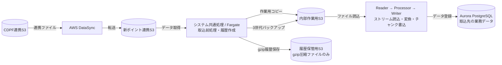

#### シーケンス図(取込処理)

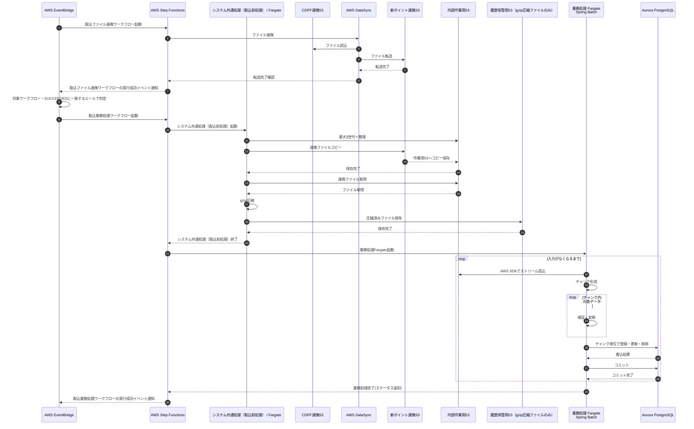

取込ファイル連携と取込業務処理は別のワークフローとし、EventBridgeは連携ワークフローの実行成功イベントを条件に業務処理ワークフローを起動する。失敗・タイムアウト・中止のイベントでは後続を起動しない。

### 算出処理(DbToDb)

- 原則チャンクモデルにて処理を行う。
- MyBatisPagingItemReaderやMyBatisCursorItemReaderを使用してDBからデータを取得
- Processorにて1件ずつデータを変換し、WriterにてDBに格納する。
- チャンクサイズは初期値1000程度とし、メモリ使用を考慮して適宜調整する。
- 通常のWriterはMyBatisBatchItemWriterを利用し、DBのバルクインサートを使用する。
- Insert、Updateの判断が必要な場合Classifierを使用して行い、実際に処理するWriterは通常のWriterであるMyBatisBatchItemWriterを使用する。

#### 構成・データの流れ(算出処理)

算出処理の構成要素を横方向に並べ、通信・データの流れを示す。詳細な順序は後述のシーケンス図で示す。

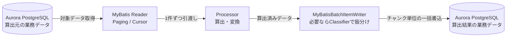

#### シーケンス図(算出処理)

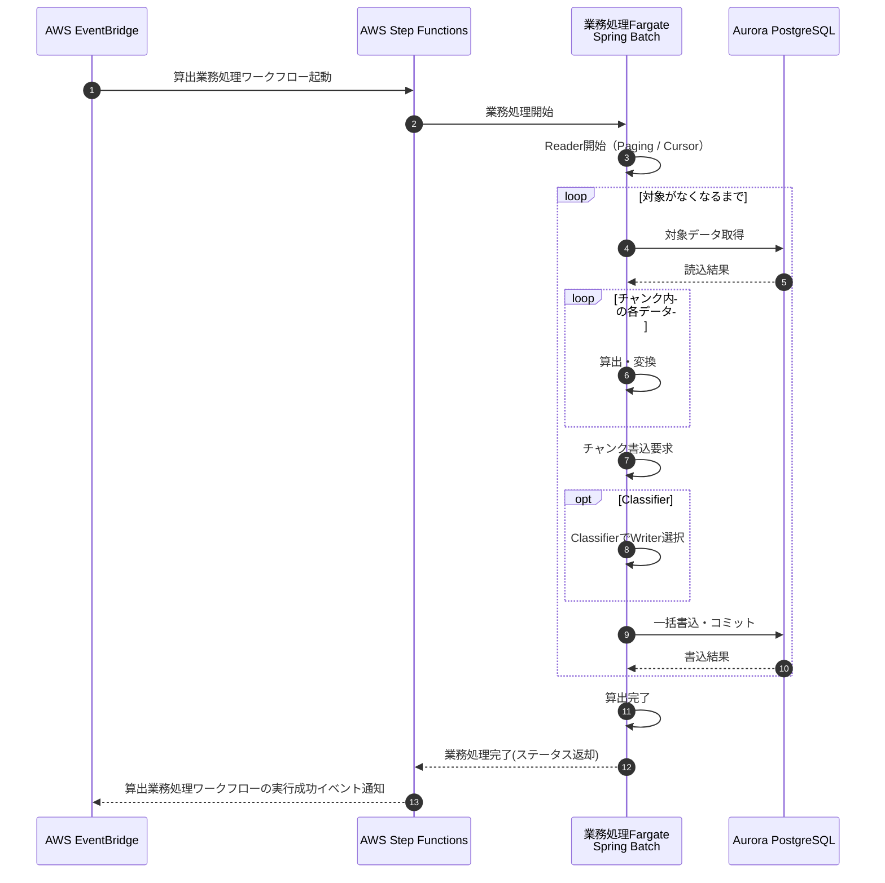

読込対象・並び順・更新後の再読込防止は業務ごとに設計し、リラン時も同じ業務結果となるようにする。

### 出力処理(DbToFile)

- 原則チャンクモデルにて処理を行う。
- MyBatisPagingItemReaderやMyBatisCursorItemReaderを使用してDBからデータを取得
- Processorにて1件ずつデータを変換し、Writerにてファイルに格納する。
- チャンクサイズは初期値1000程度とし、メモリ使用を考慮して適宜調整する。
- Writerにて内部ストレージに一時ファイルを書き込み、一定容量ごとにAWS SDKを用いて内部作業用S3に随時アップロードする。
- Writerにて内部作業用S3にアップロードする際は、AWS SDKを使用してマルチパートアップロードを行う。
- Writerにて内部作業用S3にアップロードする際は、アップロード完了後に内部ストレージの一時ファイルを削除する。
- 業務処理完了後、内部作業用S3のファイルをgzipに圧縮し履歴保管用S3にコピー(AWS CLI syncまたはcpコマンド)する。
- 業務処理完了後、内部作業用S3のファイルを新ポイントの連携S3にコピー(AWS CLI syncまたはcpコマンド)する。
- 業務処理完了後、内部作業用S3内にファイルを最大3世代として保持する。
- 新ポイントの連携S3からCDPFの連携S3へデータ連携(AWS DataSync)

#### 構成・データの流れ(出力処理)

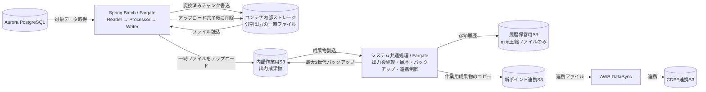

#### シーケンス図(出力処理)

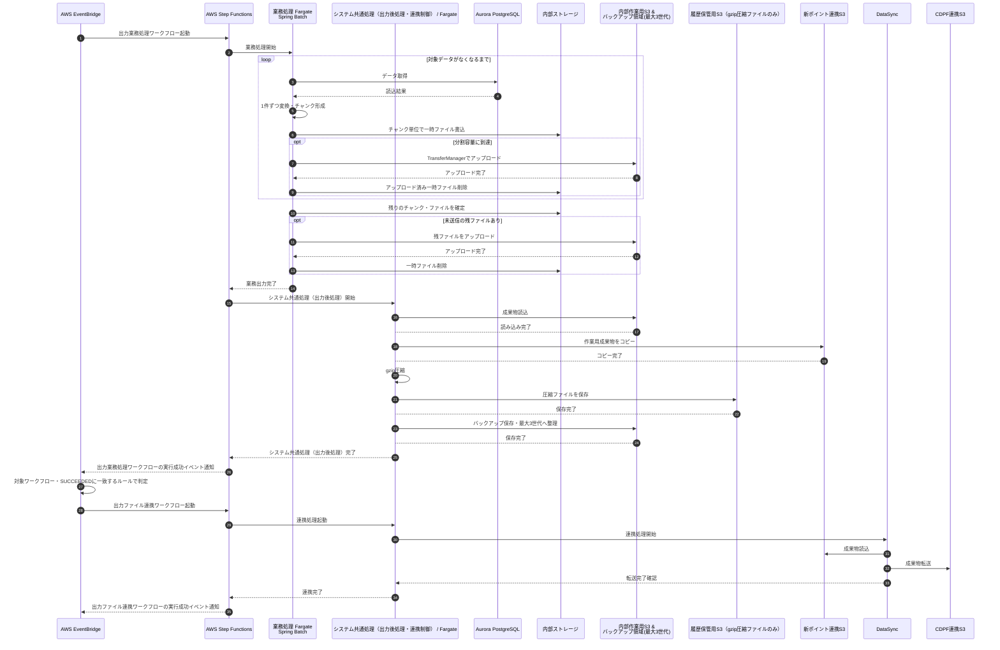

出力業務処理と出力ファイル連携は別のワークフローとし、EventBridgeは後処理まで成功した出力業務処理ワークフローの実行成功イベントを条件に連携ワークフローを起動する。失敗・タイムアウト・中止のイベントでは後続を起動しない。

### オンバッチ(シミュレーション)

原則として、業務処理ワークフローの起動元はEventBridgeではなく、AWS SDKを使用するSpring Boot APIとなる。起動後の業務処理はDbToFileまたはDbToDbと同様とする。それ以外の場合には追加検討を行う。

#### 構成・データの流れ(シミュレーション)

シミュレーションの構成要素を横方向に並べ、通信・データの流れを示す。詳細な順序は後述のシーケンス図で示す。

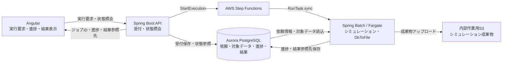

#### シーケンス図(シミュレーション)

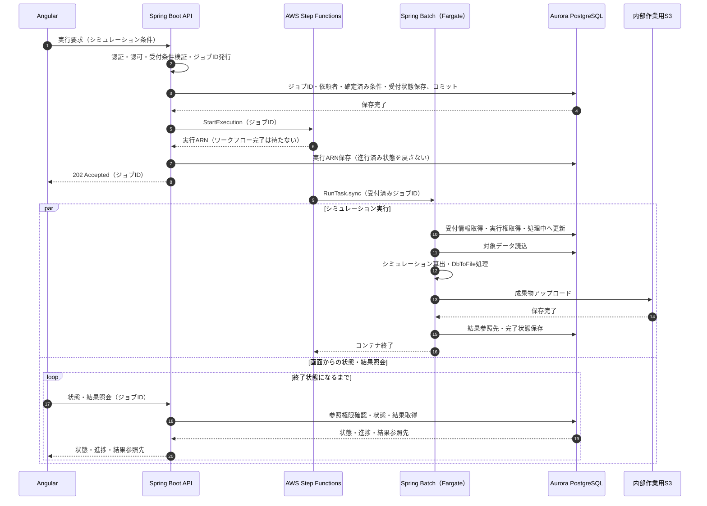

起動受付・実行中の進捗照会はオンラインの「オンバッチ」に示す。シミュレーション成果物のCDPF送出・履歴・世代バックアップの要否は業務要件で決定し、DbToFileの後処理を一律に適用しない。

## オンライン

- 稼働はAWS Fargateを使用し、コンテナとして稼働させる。
- フロントエンドとバックエンドは同じコンテナとして稼働させる。
- オンラインアプリのスペックは2vCPU、4GBメモリ、内部ストレージ50GBを想定している。
- DBはAurora PostgreSQLを利用想定。
- オンラインのログはMDCを使用し、要求ごとのリクエストIDと、認証済みの場合は利用者IDを出力する。
- オンバッチの起動・進捗照会・結果照会など、ジョブに関連する要求では、リクエストID・利用者IDに加えて対象のジョブIDを出力し、バッチ処理との対応を追跡できるようにする。
- 出力するログはlogstash-logback-encoderのLogstashEncoder等を使用してJSON形式で出力、CloudWatch Logs Insightsで検索可能なようにする。
- 出力先は標準出力(STDOUT/STDERR)に出力し、CloudWatch Logsに転送する。
- Angularのログは原則ブラウザーのConsoleに出力されるため、必要に応じてSpring Bootへログ出力APIを呼び出しサーバ側のログに出力することも検討する。
- HTTPサーバはNginxを利用する
- APサーバはTomcatを利用する
- Angularの配信は原則としてSpring Bootと同じコンテナ内に配置して配信するが、性能上の理由でAPサーバをクラスタリングする場合には別途検討する。

### フロントエンド(処理)

- Angularにて作成する。
- 画面表示・入力検証・API通信・ファイル送受信を担当する。
- DB操作やAWS SDKを用いた作業は行わない。
  - セキュリティを考慮し、DBの接続情報やAWSの接続情報などは保持しない。
- レイアウトテンプレート(CSSフレームワーク)はBootstrapを利用する。
- データの取得等はバックエンド(Spring Boot)へAPIアクセスを行い取得する。
- 入力値のバリデーションを実施する。
- 二重送信を抑止する

#### 構成・データの流れ(フロントエンド)

画面処理の構成要素を横方向に並べ、通信・データの流れを示す。詳細な順序は後述のシーケンス図で示す。

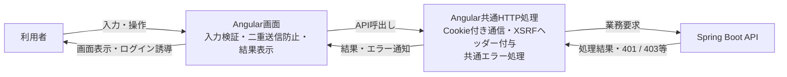

#### シーケンス図(フロントエンド)

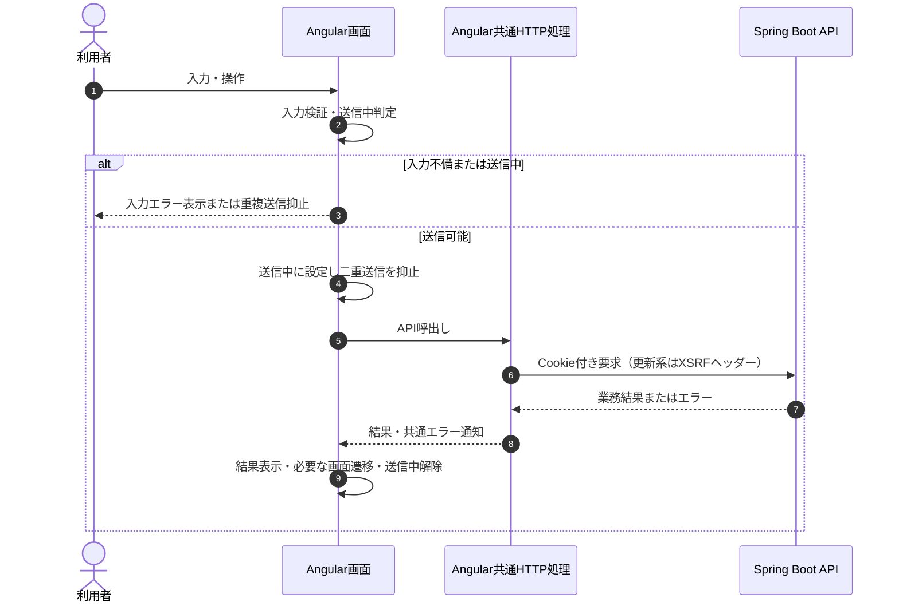

画面側の検証・二重送信抑止に加え、サーバー側でも正式な検証と業務上の重複処理防止を行う。

### バックエンド(処理)

- Spring Bootにて作成する。
- 原則REST APIとする。
- DB操作を行いフロントエンド(Angular)で利用するデータ等を収集し返却する。
- AWS S3の操作をAWS SDK(Java)を用いて行う
- AWS Step Functionsの操作をAWS SDK(Java)を用いて行う
- API引数やファイル等のバリデーションを実施する。

#### 構成・データの流れ(バックエンド)

API処理の構成要素を横方向に並べ、通信・データの流れを示す。詳細な順序は後述のシーケンス図で示す。

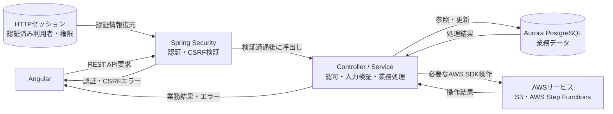

#### シーケンス図(バックエンド)

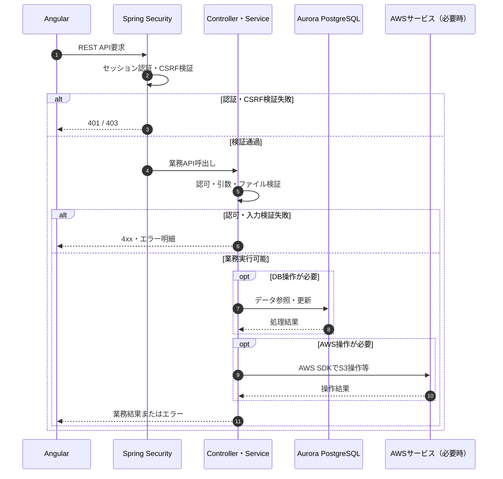

DB・AWS操作の順序と確定単位は業務ごとに定める。非同期起動・ファイル操作の具体的な手順は専用図に示す。

### オンバッチ

- Angularの画面からSpring BootのREST APIを呼び出し、Spring BootからAWS SDKのStepFunctionsClientを使用してAWS Step Functionsを実行する。
- Spring BootでAWS Step Functionsの実行予約ができたタイミングで受付完了(202 Accepted)としてジョブIDをレスポンスで返却する。
- AWS Step FunctionsへJSONでジョブIDを渡し、Spring Batchが管理DBから確定済みの業務引数を取得する。
- オンバッチ処理の進捗状況は、AWS Step Functionsの実行中に定期的にDBに格納する。
- オンバッチ処理の進捗状況はDBに格納し、Angularの画面からSpring BootのREST APIを呼び出して進捗状況を取得する。

#### 構成・データの流れ(オンバッチ)

オンバッチ受付・進捗照会の構成要素を横方向に並べ、通信・データの流れを示す。詳細な順序は後述のシーケンス図で示す。

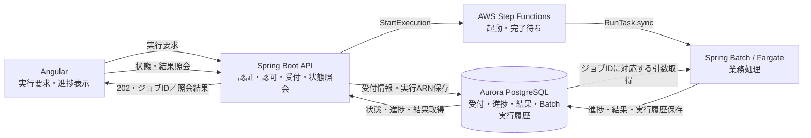

#### シーケンス図（オンバッチ）

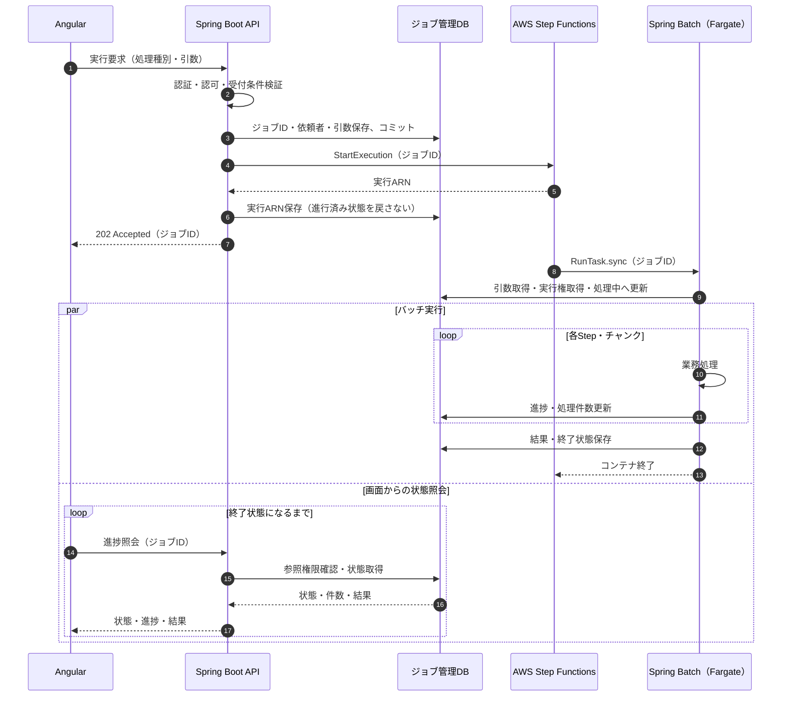

### ファイル操作

Spring BootからAWS SDKのS3Clientを使用して、S3のファイル操作を行う。

#### ファイルアップロード

##### 1MBまでのファイル

1MBちょうどは本方式、1MBを超える場合はS3直接アップロードとする。

- Angularの画面からSpring Bootへmultipart/form-dataでファイルをアップロードし、内部ストレージへ一時ファイルとして保存する。
- Spring Bootで受け取った一時ファイルをS3ClientのputObjectメソッドを使用して、S3にアップロードする。
- アップロード完了後一時ファイルを削除する。

###### 構成・データの流れ(ファイルアップロード)

Spring Boot経由アップロードの構成要素を横方向に並べ、通信・データの流れを示す。詳細な順序は後述のシーケンス図で示す。

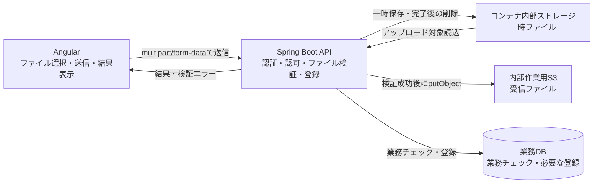

###### シーケンス図（ファイルアップロード）

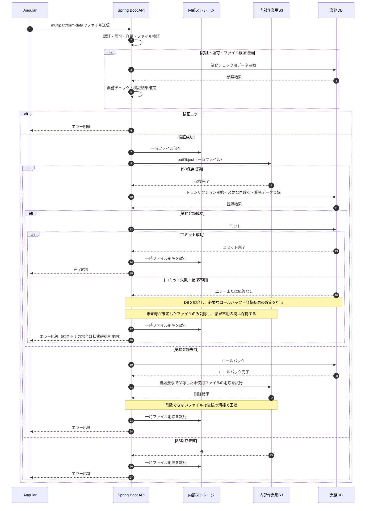

- 一時ファイルは異常時も清掃対象とする。
- S3保存と業務DB更新は同一トランザクションではない。業務登録失敗時はDBをロールバックし、当該要求で保存した未使用のS3ファイルを削除する。削除に失敗した場合は後続の清掃で回収する。
- コミットの応答が失われるなど登録結果が不明な場合は、業務DBを照合して確定するまでS3ファイルを削除しない。コミット成功後の一時ファイル削除失敗は業務登録失敗とせず、清掃対象とする。

##### 1MBを超えるファイル

- Angularの画面からSpring BootへアップロードURL発行依頼を送信する。
- Spring Bootで署名付きURLと保存先キーを発行し、Angularに返却する。
  - アップロードS3は内部作業用S3のアップロード専用フォルダとする。
  - アップロード先バケットはS3バージョニングを有効化し、Version IDで対象ファイルを固定できることを前提とする。
  - 署名付きURLは有効期限を必ず設ける
  - 署名付きURLは有効期間内に再利用され、同じキーへ上書きされ得るため、処理対象Version IDを固定する。
  - アップロード元の削除はURLの期限経過後、使用状態と保持期間を確認して行う。
- Angularで署名付きURLを使用してS3に直接アップロードする。
- アップロード完了後、AngularからSpring Bootへアップロード完了通知を送信する。
- Spring Bootで依頼者・保存先を確認し、S3Clientでファイルの実在・実サイズ・Version IDを確認して処理対象を固定する。
- アップロード完了後、必要に応じてSpring BootでS3Clientを使い、確認した対象バージョンを業務処理用フォルダにコピーする。
- アップロード専用フォルダのファイル削除タイミングは有効期限が切れてからとし、使用状態・保持期間を確認する（具体的な期間は別途確定）。
- アップロード完了は、APIがS3上の対象ファイルを確認し、保存先・Version IDと完了状態を記録した時点とする。
- アップロード後の全件検証・業務登録は別の処理とする。必要な場合は、確定したファイルを入力として取込処理・オンバッチを起動する。ファイル容量だけを理由にSpring Batchを起動しない。

###### 構成・データの流れ(大容量ファイルアップロード)

S3直接アップロードと保存確認までの通信・データの流れを示す。アップロード後の取込処理・オンバッチは本図の範囲外とし、詳細な実行方式は各処理の節で示す。

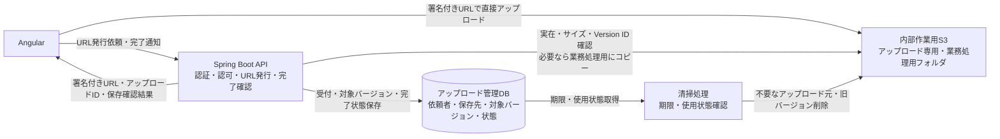

###### シーケンス図(大容量ファイルアップロード)

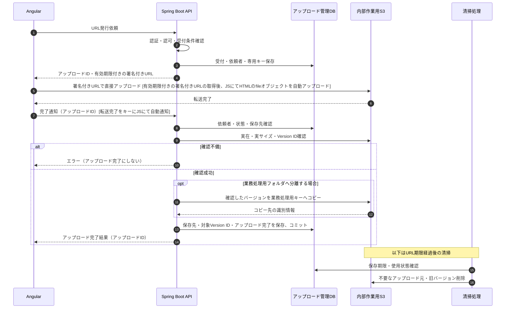

#### ファイルダウンロード

- Angularの画面からSpring BootへダウンロードURL発行依頼を送信する。
- Spring Bootで対象の参照権限を確認し、署名付きURLを発行してAngularに返却する。
  - 署名付きURLは有効期限を必ず設ける
- Angularで署名付きURLを使用してS3から直接ダウンロードする。

##### 構成・データの流れ(ファイルダウンロード)

ダウンロードの構成要素を横方向に並べ、通信・データの流れを示す。詳細な順序は後述のシーケンス図で示す。

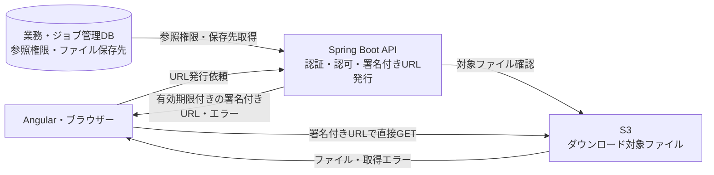

##### シーケンス図(ファイルダウンロード)

```mermaid
sequenceDiagram
    autonumber
    participant U as Angular・ブラウザー
    participant A as Spring Boot API
    participant D as 業務・ジョブ管理DB
    participant S as S3
    U->>A: URL発行依頼（ファイル識別子）
    A->>D: 参照権限・保存先確認
    alt 参照不可
        A-->>U: エラー応答
    else 参照可能
        A->>S: 対象ファイル確認
        S-->>A: ファイル情報
        A->>A: ダウンロード用の有効期限付きの署名付きURL生成
        A-->>U: 署名付きURL
        U->>S: URLで直接GET [JSにて自動DL開始]
        S-->>U: ファイルまたは取得エラー
    end
```

署名付きURL生成はAPI側で行う。S3確認・転送失敗はエラー表示し、期限切れの場合はAPIで権限を再確認してURLを再発行する。

### 認証

#### フロントエンド(認証)

- サーバー側の認証状態は管理しない。利用者・権限を画面表示・遷移制御用にメモリ保持し、必要に応じてAPIでセッションを復元する。
- APIリクエスト時にCookieにJSESSIONIDと更新系要求のヘッダーにX-XSRF-TOKENをセットしアクセスを行う。
- 認証状態の確認はアクセス毎にAPIアクセス時にSpring Bootにて実施する。
- 401では利用者情報を消去してログインへ誘導し、403では権限不足・CSRF不正等のエラーを表示する。

##### 構成・データの流れ(フロントエンド[認証])

画面側の認証の構成要素を横方向に並べ、通信・データの流れを示す。詳細な順序は後述のシーケンス図で示す。

```mermaid
flowchart LR
    U["利用者"]
    A["Angular画面<br/>ログイン画面・SessionService・Guard"]
    H["Angular共通HTTP処理<br/>Cookie付き通信・XSRFヘッダー付与"]
    B["Spring Boot API<br/>認証API・業務API"]
    M[("ブラウザーのメモリ<br/>表示用の利用者・権限")]
    U -->|"ログイン入力・業務操作"| A
    A -->|"CSRF取得・ログイン・セッション復元・業務要求"| H
    H -->|"Cookie付きAPI通信"| B
    B -->|"利用者・権限・CSRF・結果・401 / 403"| H
    H -->|"結果・共通エラー通知"| A
    A -->|"利用者情報保持・消去"| M
    M -->|"画面遷移・表示の判断に利用"| A
    A -->|"画面表示・ログイン誘導・エラー表示"| U
```

##### シーケンス図(フロントエンド[認証])

```mermaid
sequenceDiagram
    autonumber
    actor U as 利用者
    participant A as Angular画面・SessionService・Guard
    participant H as Angular共通HTTP処理
    participant B as Spring Boot認証API
    opt メモリ上に利用者情報がない
        A->>H: セッション復元要求
        H->>B: GET /api/auth/me（Cookie）
        B-->>H: 利用者・権限または401
        H-->>A: 利用者・権限または未認証通知
        A->>A: 復元できた利用者情報をメモリ保持
    end
    opt 未認証のためログインが必要
        A->>H: CSRF取得要求
        H->>B: GET /api/auth/csrf
        B-->>H: CSRFトークン・Cookie
        H-->>A: CSRF取得完了
        U->>A: ID・パスワード入力
        A->>H: ログイン要求（ID・パスワード）
        H->>B: POST /api/auth/login（XSRFヘッダー）
        alt 認証成功
            B-->>H: 利用者・権限・セッションCookie
            H-->>A: 利用者・権限
            A->>A: 利用者情報をメモリ保持
            A->>H: CSRF再取得要求
            H->>B: GET /api/auth/csrf（ログイン後の再取得）
            B-->>H: 新CSRFトークン・Cookie
            H-->>A: CSRF再取得完了
        else 認証失敗
            B-->>H: 401
            H-->>A: 認証失敗通知
            A-->>U: ログインエラー表示
        end
    end
    opt 認証済み・画面権限確認後の業務操作
        A->>H: 業務API呼出し
        H->>B: 業務API（Cookie・更新系XSRFヘッダー）
        B-->>H: 結果または401 / 403
        H-->>A: 結果・共通エラー通知
        A->>A: 結果表示・401ならログイン誘導・403ならエラー表示
    end
```

#### バックエンド(認証)

- 認証状態の実態はSpring BootのSessionで管理を行う
- Angular(ブラウザー)のJSESSIONID Cookieからセッション認証情報を復元する。更新系要求ではX-XSRF-TOKENヘッダーを用いて別途CSRF検証を実施する。
- 認証で問題のある場合には『401 Unauthorized』や『403 Forbidden』等を返却する。
- 認証に問題がない場合には後続の業務処理を行い、結果を返却する。

##### 構成・データの流れ(バックエンド[認証])

サーバー側の認証・認可の構成要素を横方向に並べ、通信・データの流れを示す。詳細な順序は後述のシーケンス図で示す。

```mermaid
flowchart LR
    A["Angular"]
    S["Spring Boot"]
    M["セキュリティー基盤"]
    H[("HTTPセッション<br/>SecurityContext")]
    A -->|"CSRF取得・ログイン・ログアウト・業務要求"| S
    S -->|"ログイン時の認証要求"| M
    M -->|"照合結果"| S
    S -->|"認証情報保存・ログアウト時の無効化"| H
    H -->|"認証情報復元"| S
    S -->|"業務結果・権限エラー"| A
    S -->|"Cookie・利用者情報・認証エラー"| A
```

##### シーケンス図(バックエンド[認証])

```mermaid
sequenceDiagram
    autonumber
    participant A as Angular
    participant S as Spring Boot
    participant H as HTTPセッション（SecurityContext）
    participant M as セキュリティー基盤

    Note over A,H: CSRF取得・ログイン
    A->>S: GET /api/auth/csrf
    S-->>A: CSRFトークン・Cookie
    A->>S: POST /api/auth/login
    S->>S: CSRF・入力検証
    alt CSRF・入力検証成功
        S->>M: ログイン時の認証要求
        M-->>S: 照合結果
        alt 認証成功
            S->>H:SecurityContext保存
            S-->>A: 200・利用者情報・Cookie
            A->>S: GET /api/auth/csrf（ログイン後の再取得）
            S-->>A: 新CSRFトークン・Cookie
        else 認証失敗
            S-->>A: 401
        end
    else CSRF・入力検証不備
        S-->>A: 400 / 403
    end
    Note over A,H: 以下は別の業務API要求
    A->>S: 業務要求（JSESSIONID・更新系XSRFヘッダー）
    S->>H: JSESSIONIDに対応する認証情報取得
    H-->>S: SecurityContext（存在する場合）
    S->>S: 認証・CSRF検証
    alt 認証・CSRF検証通過
        S->>S: 操作・対象データの権限確認
        alt 権限あり
            S->>S: 業務処理
            S-->>A: 業務結果
        else 権限不足
            S-->>A: 403
        end
    else 未認証またはCSRF不正
        S-->>A: 401 / 403
    end
    opt ログアウト（有効なCSRF取得後）
        A->>S: POST /api/auth/logout（Cookie・XSRFヘッダー）
        S->>S: CSRF検証
        alt 検証成功
            S->>H: セッション無効化
            S->>S: 認証情報・CSRF消去
            S-->>A: 200・JSESSIONID削除Cookie
        else CSRF不正
            S-->>A: 403
        end
    end
```

- CSRFトークンは認証資格情報ではなく、セッションCookieによる認証とは別に検証する。
